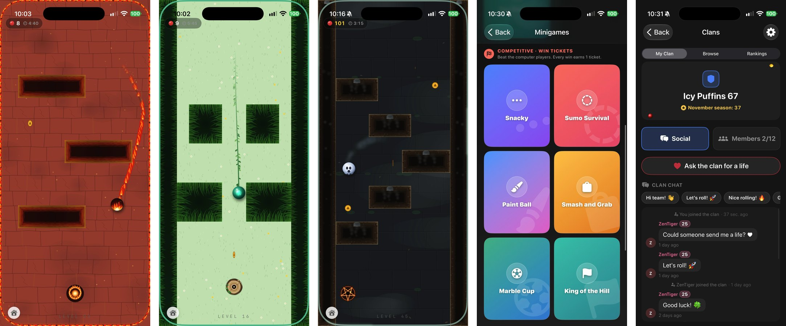

# Roll Along

**A tilt-to-roll marble game for iPhone, built end to end: game, backend, in-app purchases, ads, and App Store release.**

Tilt your phone, roll the marble, dodge the holes, reach the goal. An endless Adventure mode, 10 minigames, clans with monthly seasons, and a shop of animated cosmetics.

**Status:** version 1.0 is live. [Get it on the App Store](https://apps.apple.com/app/roll-along-marble-maze/id6774455345). · [Support page](https://mfaldet.github.io/roll-along/) · [Privacy](https://mfaldet.github.io/roll-along/privacy.html)

---

## At a glance

| | |
|---|---|
| **Platform** | iOS 18+, iPhone |
| **App** | Swift, SwiftUI, CoreMotion, StoreKit 2, Sign in with Apple, Google AdMob |
| **Backend** | Supabase: Postgres, row-level security, scheduled jobs (pg_cron), one edge function |
| **Size** | About 87,000 lines of Swift (71,500 app, 15,700 tests) and 4,900 lines of SQL |
| **Tests** | 634 unit tests, plus snapshot tests for the renderers |
| **Art** | Every marble, floor, trail, and effect is drawn in code with SwiftUI `Canvas`. The only image file is the app icon |

---

## What's in the game

**Adventure.** An endless run of generated levels that get harder as you climb. Each level is scored on stars. Lives refill at one every 6 minutes, up to 10.

**10 minigames.**

| Kind | Games |
|---|---|
| Solo, played for a best score | Roll Up, Disco Ball, Zen Garden, Snacky |
| Competitive, against computer players on Easy, Normal, or Hard | Sumo Survival, Paint Ball, Smash and Grab, Marble Cup, King of the Hill, Snacky |
| Reward | Gold Rush, paid for with tickets won in competitive games |

**Clans and seasons.** Clans of up to 12, clan chat built from preset phrases, life requests between clanmates, and a monthly season that ranks every clan and pays coin prizes by tier.

**Cosmetics.** 17 full collections at launch and more on a release calendar. A collection is six pieces designed to be worn together: ball, goal, trail, floor, pit, and boundary. Many are animated, and all of them hold still when Reduce Motion is on.

**Trophies, leaderboards, friends.** Trophies with rarity based on how many players hold each one, global leaderboards for Adventure and each minigame, and friend codes.

---

## The economy

The game runs on three currencies, each with one job.

| Currency | Comes from | Goes to | Job |
|---|---|---|---|
| **Coins** | Level clears, the daily reward, Gold Rush, clan season prizes, coin packs | Cosmetics | The long-term chase |
| **Lives** | Time, a rewarded ad, clanmates, life packs | Adventure attempts | Pacing |
| **Tickets** | Winning competitive minigames | Gold Rush rounds | Turns skill into coins |

The numbers are set in a few places on purpose, so the balance between free play and paid can be changed without touching the rest of the game:

- **Prices** come from one tier ladder (750, 1,000, 1,250, 1,500 coins). Changing a tier reprices every item in it.
- **Payouts** come from one table in code (`CoinPayouts`). Nothing else computes a reward.
- **Clan prizes, life-request rules, and season thresholds** are settings in the database, so they change without an app update.
- **Cosmetic releases** follow a calendar table in the database.

Every reward and price was checked against what the screen promises before release: 33 items, 7 mismatches found and fixed. See [`docs/economy/2026-11-payout-audit.md`](docs/economy/2026-11-payout-audit.md), and the earn-rate math in [`docs/economy/2026-11-coin-rebalance.md`](docs/economy/2026-11-coin-rebalance.md).

---

## How it's built

**Physics and input.** `CMMotionManager` publishes a 2D gravity vector at 60 Hz with a small dead zone. A display-link clock drives a custom tick engine at 60 fps and pauses when the app leaves the foreground.

**Rendering.** All game art is SwiftUI `Canvas`. One renderer draws every ball, so a skin looks the same on the home screen, in the shop, and in play. Animated pieces use `TimelineView`.

**Accounts.** Sign in with Apple, optional. Player and clan names are built from preset word lists, so there is no free-text name to moderate. Account deletion runs in an edge function that also revokes the Apple sign-in.

**Backend.** Postgres on Supabase. Row-level security on player data, server functions for anything that pays out, and scheduled jobs that close seasons, expire life requests, roll up trophy rarity, and trim old analytics.

**Purchases and ads.** StoreKit 2 with 10 products (coin packs, life packs, a starter pack, and unlimited lives), including restore. Rewarded ads only, through AdMob, limited to general-audience content.

**Analytics.** The app batches its own events to the database, with 90-day retention. No third-party analytics SDK.

---

## Running it

Open `RollAlong.xcodeproj` in Xcode 16 or later and run on a physical iPhone with iOS 18 or later. The simulator does not report device motion.

To test purchases locally, select `Products.storekit` under the scheme's **Run → Options → StoreKit Configuration**.

---

## More

- [`docs/economy/`](docs/economy/): the coin economy, pricing, and audits
- [`docs/cosmetics/quality-standard.md`](docs/cosmetics/quality-standard.md): the standard every cosmetic is held to
- [`docs/trophies/`](docs/trophies/): trophy design
- [`docs/app-review/`](docs/app-review/): App Store review notes and in-app purchase reference

© 2026 Mackenzie Faldet. All rights reserved.
