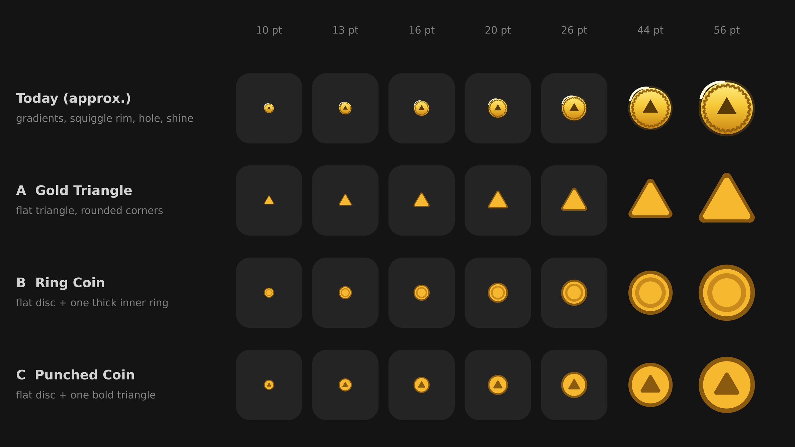

# Coin icon: three flat proposals

**Chosen: C, built 2026-11-17.** Every coin in the app (icons, coin-pack
piles, Gold Rush and Smash and Grab coins, and the spinning coin in levels) is
now drawn by `CoinFace` in `RollAlong/BallGameView.swift`. The name stays
"coins"; nothing was renamed. The rest of this page is the original proposal.

One sheet per design: [A](coin-proposal-a.png), [B](coin-proposal-b.png),
[C](coin-proposal-c.png). The images are drawn at 3× scale, as on a phone, on
the game's dark background (`Color(white: 0.08)`); sizes up to 26 pt sit on a
card or pill (`Color(white: 0.14)`), as they do in the game. They are made by
`render_coins.py` in this folder (Python with Pillow). The "today" row is an
approximation of the current coin, redrawn from its code.

## Where the coin appears today, and at what size

The coin is `CoinIcon(size:)` in `RollAlong/BallGameView.swift:6943`. It is a
gold disc with a three-stop gradient, a 28-wave squiggle traced around the
rim, a triangle hole with its own gradient and lip, a white highlight crescent
and a drop shadow. The squiggle and highlight are what make it busy: below
about 20 pt they turn into a fuzzy edge.

| Size (pt) | Where |
|---|---|
| 9–12 | Coin piles on the Get Coins pack icons (`PurchaseSheets.swift:831`–`910`), leaderboard coin column (`LeaderboardView.swift:369`), game menu (`GameMenuView.swift:254`) |
| 13–14 | Shop prices and bundle prices (`CosmeticShopView.swift:754`, `1206`, `1362`, `1864`) |
| 16–18 | Level HUD (`BallGameView.swift:4025`), shop balance (`CosmeticShopView.swift:520`), level select (`LevelSelectView.swift:149`), Home coin pill (`HomeView.swift:1163`), pack piles (`PurchaseSheets.swift:777`–`799`) |
| 20–22 | Gold Rush falling coins (20, platinum 27: `GoldRushView.swift:210`), streak sheet (`DailyRewardView.swift:105`, `144`), Get Coins header (`PurchaseSheets.swift:617`) |
| 26 | Level-complete coin line (`BallGameView.swift:4645`) |
| 40–46 | Minigame result screens (Comet Clash, Sumo, Paint Ball, Smash and Grab, Marble Cup, King of the Hill, Roll Up, Roll Out, Disco Ball), Adventure result (`BallGameView.swift:4763`) |
| 56 | Purchase confirmation (`PurchaseSheets.swift:1417`) |

The coins you pick up inside a level are a separate view, `SpinningCoinView`
(`BallGameView.swift:6714`), which shows the coin turning edge-on. It borrows
the same gold gradient. Whichever design is chosen, that view should be
redrawn to match, flat.

## The three designs

All three use the same three colors, so the game keeps one gold:

| Name | Hex | Use |
|---|---|---|
| Face gold | `#F5B82E` | the fill |
| Dark gold | `#8A5A0E` | outline and the one mark |
| Mid gold | `#C98A1B` | design B's inner ring only |

Platinum (Gold Rush's three-point coin) would use the same shapes in
`#D9E2EC` (face) and `#6B7B8F` (outline and mark).

No gradients, no highlight, no shadow, no rim detail. Each is one fill, one
outline and at most one mark.

### A — Gold Triangle

A gold equilateral triangle with rounded corners and a dark outline.

- Size: the triangle's circumradius is 0.56 × the icon size, so it fills the
  same box as a disc. It is shifted down by 0.07 × size so it looks centered.
- Outline: 0.085 × size. Corner radius: about 0.09 × size.
- SwiftUI: one `Shape` with three `addArc(tangent1End:tangent2End:radius:)`
  corners, filled, then stroked. About 20 lines.
- Reads clearly at every size and is unlike anything else in the game.
- Against it: a triangle has less area than a disc of the same size, so it
  looks smaller at 9–13 pt, and the pickup coin inside levels would lose its
  coin look (a spinning triangle reads less as money).

### B — Ring Coin

A gold disc with a dark outline and one thick inner ring.

- Outline: 0.08 × size. Inner ring: radius 0.30 × size, width 0.09 × size, in
  mid gold.
- SwiftUI: `Circle().fill`, `Circle().stroke` for the outline, a second
  `Circle().stroke` inset for the ring. About 10 lines.
- Unmistakably a coin, and the simplest to draw.
- Against it: the ring is low contrast (mid gold on gold) and disappears below
  about 13 pt, where it becomes a plain gold dot. It also loses the triangle
  that ties the coin to the game today.

### C — Punched Coin (recommended)

A gold disc with a dark outline and one bold dark triangle in the middle.
Today's coin with everything but the essentials taken away.

- Outline: 0.08 × size. Triangle: circumradius 0.25 × size, slightly rounded
  corners, shifted down 0.03 × size so it looks centered.
- SwiftUI: `Circle().fill`, `Circle().stroke`, and the existing `CoinTriangle`
  shape filled. About 12 lines; `CoinSquiggle` and the gradients go away.
- Reads as a coin at every size, and the triangle stays visible down to
  10 pt because it is dark on light.
- Keeps the game's identity: the triangle is already the coin's mark, and the
  in-level spinning coin can keep it.

**Recommendation: C.** It is the clearest at the small sizes where the coin
appears most (prices, the HUD, the Home pill), it needs no new learning from
players, and it is the smallest code change. Choose A if you want the coin to
be a triangle outright; the main cost is that small coins look smaller and
the spinning pickup needs a new idea.

## What renaming coins to "chips" would touch

Counted on the branch as of this proposal.

**Player-visible text in the app: about 100 strings in 25 Swift files.** The
heaviest are mode descriptions and payout lines (`GameMode.swift`, 17),
Adventure and result screens (`BallGameView.swift`, 16), the purchase sheets
(8), the shop (8), Gold Rush (7), game state messages (6), Settings (5) and
level select (5). Plus accessibility labels such as "750 coins" on buttons,
which are part of those strings. Each is a word change, but every sentence has
to be reread ("Coins for every goal" → "Chips for every goal").

**Trophies:** 6 trophies say "coin" in their title or text
(`coinpit_catch_90`, `cosmetic_first_buy`, `econ_nest_egg`,
`econ_working_capital`, `econ_pit_boss`, `skill_spotless`), in
`RollAlong/TrophyCatalog.json` and `docs/trophies/trophy-list.md`.

**In-app purchases (App Store Connect):**
- Six products have "coins" in their display name and description: the five
  coin packs and the Starter Pack ("3,750 coins + …"). These are edited in
  App Store Connect for each product, and in `RollAlong/Products.storekit`
  (22 mentions) for local testing. Apple expects the product names to match
  what the app shows, so the two must change together, and the change goes
  through review with the next build.
- The product IDs (`com.macfaldet.RollAlong.coins.100` and so on) cannot be
  renamed once created in App Store Connect, and do not need to be: players
  never see them.
- The screenshots for each product (review screenshots) would need retaking.

**Documents:** `docs/app-review/in-app-purchases.md` (12 mentions),
`docs/app-review/review-notes.md` (6), `README.md` (7), the economy notes in
`docs/economy/`. The privacy page does not mention coins.

**Should NOT change:**
- Analytics event and property names (`buy_coins_sheet_opened`, `coins`,
  `base_coins`, `coin_balance`, `coins_picked` and so on). Renaming them splits the history in two: every query would need both
  names, and the before/after comparison you would want most becomes harder.
- Database column names such as `players.coins_collected` and the
  leaderboard's coin column. They are not shown to players; renaming them
  needs a migration on the live database and an app update at the same time.
- Code identifiers (`coinBalance`, `CoinIcon`, `addCoins`). Renaming them is
  churn with no player benefit.
- Saved-data keys in `UserDefaults`. Renaming them would wipe players'
  balances unless migrated.

**Names that would need a decision:** "Coin Pit" (the internal id is
`coinpit`; its player-facing name is already Gold Rush), the "Money Ball"
skin and "Money" collection, the Gold Rush and Smash and Grab descriptions
("Grab the most coins"), and coin-themed trophy names ("Nest Egg", "Pit
Boss", "High Roller").

**Tests:** about 39 string assertions in `RollAlongTests` and
`RollAlongUITests` mention coins; the ones that check player-visible text
would need updating.

**Size:** roughly half a day of careful text editing and testing, plus the App
Store Connect edits and new purchase screenshots.

**Risks, plainly:**
- "Chips" reads as casino chips. The app is rated 9+ and sells its
  currency for real money. Apple's guidelines restrict anything that looks
  like real-money gambling (guideline 5.3) and are strict about paid random
  items (3.1.1); the shop has no paid random items today. Calling the paid
  currency
  "chips" invites a reviewer to look harder at that, and a few existing names
  (the "High Roller" trophy with its dice icon, "Pit Boss", and Gold Rush's
  stake and time tickets) would read as casino terms next to it.
- The age rating questionnaire asks about simulated gambling. "Chips" alone
  does not make the game simulated gambling, but it moves the wording closer.
- Recommendation: keep "coins".
